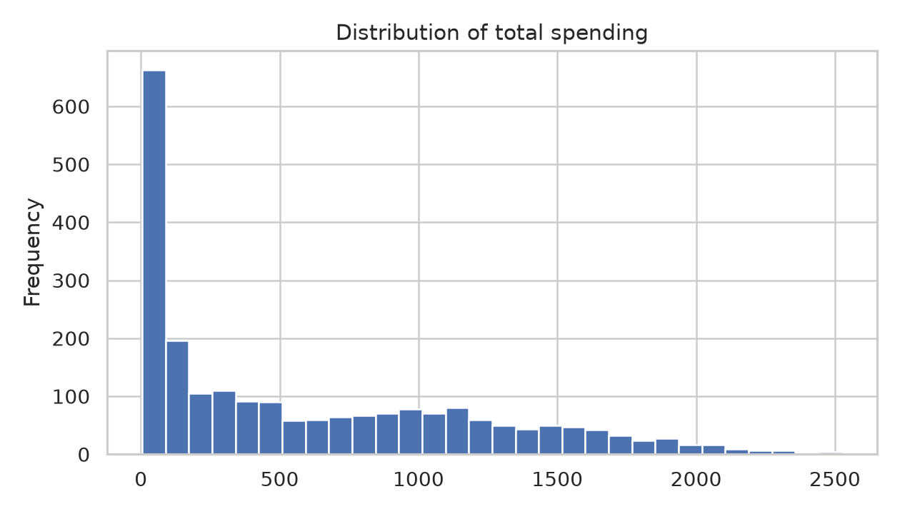
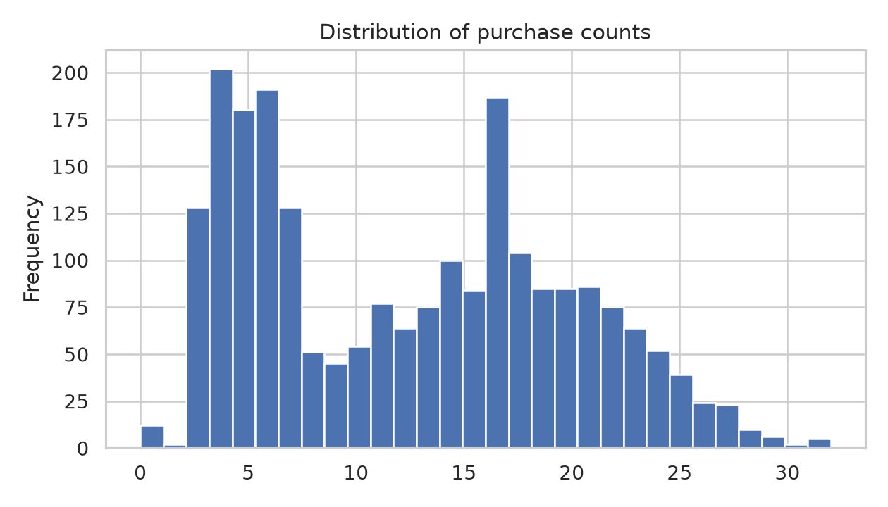
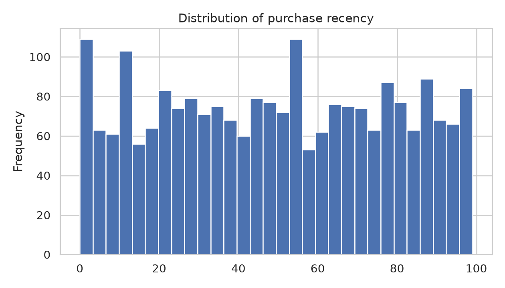
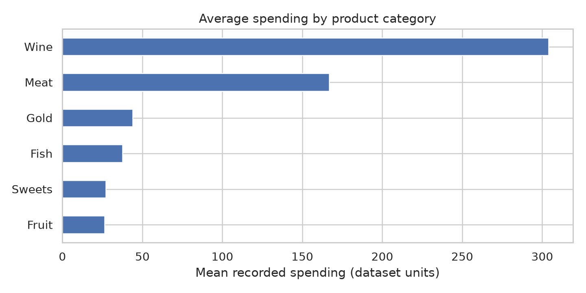
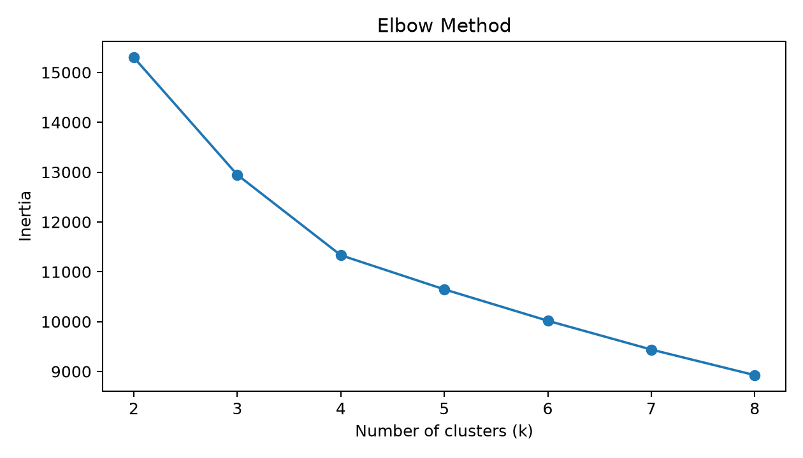
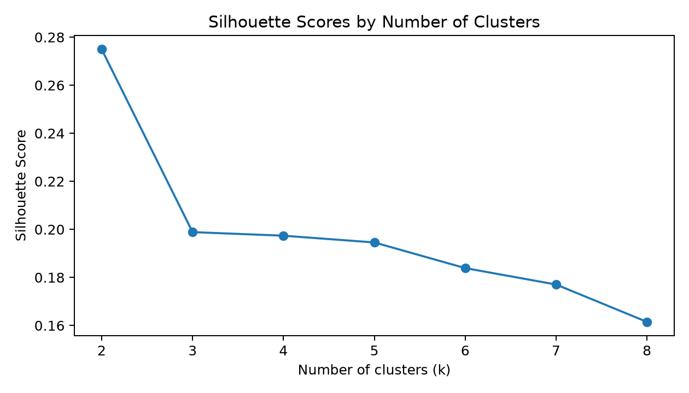
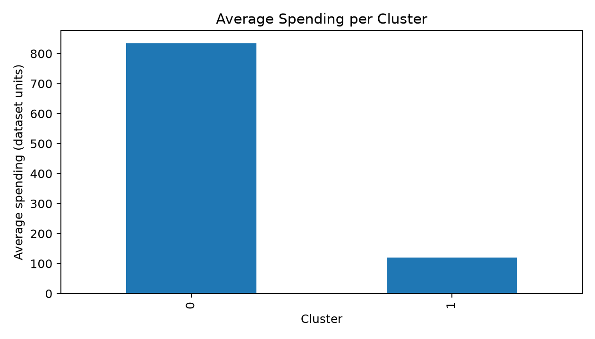
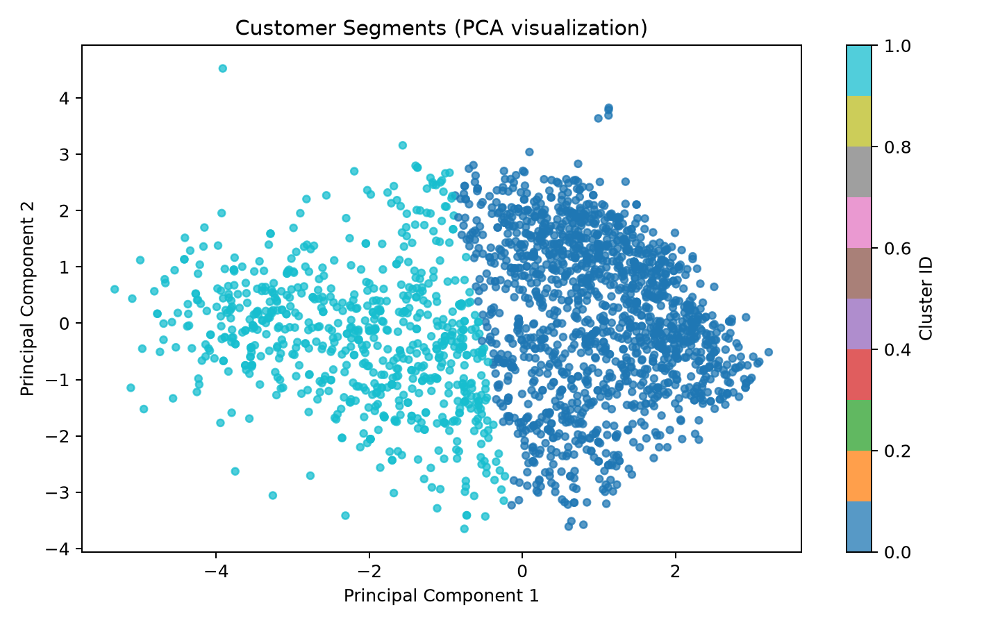
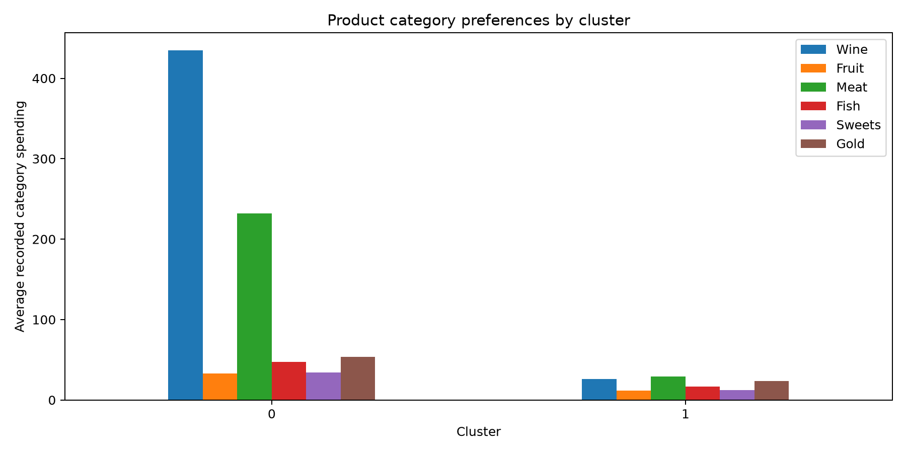

# Customer Segmentation Using Purchasing Behaviour

**Major Project:** Unsupervised Learning  
**Project Title:** Customer Segmentation Using Purchasing Behaviour  
**Team Members:** Rahil Husain Shaikh and Naina Finny  
**Approach:** K-Means clustering with exploratory data analysis (EDA), feature engineering, silhouette-based model selection, and PCA visualization  
**Implementation:** Python, Pandas, NumPy, Scikit-learn, Matplotlib, Seaborn, and Jupyter Notebooks

> **Complete project report:** This README contains the abstract, data and methodology, experimental results, evaluation, figures, interpretation, limitations, and references.

> **Project summary:** An analysis of **2,240 customers** identified **two purchasing-behaviour segments**. The selected K-Means model achieved a **silhouette score of 0.275** (estimated on a reproducible 1,500-customer sample). The segments differ substantially in average spending and recorded purchase counts, but not meaningfully in recency.

## Abstract

Understanding how customers differ in their purchasing behaviour helps businesses plan more relevant promotions, customer engagement, and product recommendations. This project applies **unsupervised learning** to discover customer groups without using predefined customer-segment labels. The [Customer Personality Analysis dataset](https://www.kaggle.com/datasets/imakash3011/customer-personality-analysis) contains **2,240 customer records and 29 original attributes**. Purchasing-related variables were cleaned and transformed into customer-level features representing total spending, recorded purchase count, purchase recency, and proportional spending across six product categories. Nine features were standardized and clustered with **K-Means**. Candidate cluster counts from **k = 2 to 8** were evaluated using inertia and silhouette score; **k = 2** had the highest silhouette score (0.275). The resulting segments include **1,523 relatively higher-spending, more frequent purchasers** and **717 relatively lower-spending, less frequent purchasers**. A two-component PCA projection was used to visualize the segments, capturing **53.8%** of variance in the standardized inputs. These descriptive findings suggest directions for segment-specific marketing, while the modest silhouette score and observational nature of the dataset limit the strength of the conclusions.

**Keywords:** Customer segmentation, unsupervised learning, K-Means, purchasing behaviour, feature engineering, silhouette score, PCA.

## 1. Problem statement and objectives

Customers differ in how much they spend, how often they purchase, and which categories they prefer. Treating every customer as part of one uniform group may hide useful patterns. This project investigates whether purchasing records can be organized into meaningful customer segments **without known ground-truth segment labels**.

**Objectives:**

1. Clean and explore the purchasing dataset.
2. Create customer-level spending, purchase-count, recency, and product-preference features.
3. Compare possible K-Means cluster counts using the Elbow Method and silhouette scores.
4. Visualize the identified segments and interpret their behaviour.
5. Suggest practical, evidence-informed uses for the segments, without claiming that any marketing action has been experimentally proven effective.

## 2. Dataset

- **Source:** [Kaggle — Customer Personality Analysis](https://www.kaggle.com/datasets/imakash3011/customer-personality-analysis)
- **Original file:** `data/marketing_campaign.csv` (tab-separated, so read with `sep="\t"`)
- **Original size:** 2,240 records × 29 columns
- **Customers included in the analysis:** 2,240
- **Data context:** Historical purchasing and marketing records; values should not be interpreted as live customer behaviour.

### Purchasing variables used

| Variable(s) | Meaning in this project |
|---|---|
| `MntWines`, `MntFruits`, `MntMeatProducts`, `MntFishProducts`, `MntSweetProducts`, `MntGoldProds` | Recorded expenditure in six product categories |
| `NumWebPurchases`, `NumCatalogPurchases`, `NumStorePurchases` | Recorded purchases by channel |
| `Recency` | Days since the customer's last purchase at the time of historical data collection |

The `ID` column identifies customers but is **not** a clustering feature. This project does not train a supervised model to predict `Response` or other target labels.

## 3. Data preparation and exploratory analysis

The preparation workflow is implemented in [`01_data_preparation.ipynb`](notebooks/01_data_preparation.ipynb).

1. Load the tab-separated CSV with Pandas and inspect its columns, missing values, and repeated customer IDs.
2. Check purchasing-related fields for missing or invalid values and remove duplicate IDs where present. Missing `Income` is not, by itself, a reason to exclude a customer because `Income` is not used to train this model.
3. Create `Total_Spending` as the sum of the six product-category spending columns.
4. Create `Purchase_Frequency` as the sum of web, catalog, and store purchase counts. **This is a recorded purchase-count proxy, not a monthly or yearly purchase rate.** Deal purchases are excluded from this sum because they may overlap with channel counts.
5. Create each category's `..._Share` as that category's spending divided by the customer's total spending, with a safe handling rule for a zero total.
6. Save processed observations to `data/clean_customers.csv` and generate EDA figures.

### EDA figures

**Distribution of customer spending**



**Distribution of recorded purchase counts**



**Historical purchase recency distribution**



**Mean expenditure across product categories**



These plots provide descriptive context before the clustering experiment; they do not, on their own, establish distinct customer groups.

## 4. Machine learning methodology

The model implementation is in [`02_clustering.ipynb`](notebooks/02_clustering.ipynb).

### 4.1 Input features

The model uses **nine features**:

- `Log_Total_Spending` = `log1p(Total_Spending)`
- `Log_Purchase_Frequency` = `log1p(Purchase_Frequency)`
- `Recency`
- Six category-specific spending-share variables (`MntWines_Share`, `MntFruits_Share`, `MntMeatProducts_Share`, `MntFishProducts_Share`, `MntSweetProducts_Share`, `MntGoldProds_Share`)

Logarithmic transformations reduce skew in total spending and purchase counts. `StandardScaler` then standardizes the nine inputs so that raw numerical ranges do not automatically dictate distances in K-Means.

### 4.2 Clustering and model selection

K-Means assigns each customer to one of `k` clusters using distances to cluster centers. We compared **k = 2, 3, 4, 5, 6, 7, 8**, with `random_state=42` and `n_init=10`.

- **Inertia:** Within-cluster sum of squared distances, used for the Elbow Method. Inertia normally decreases as more clusters are added, so lower inertia alone is not sufficient to select `k`.
- **Silhouette score:** Measures relative within-cluster cohesion and between-cluster separation; larger scores are generally preferable. Scores were **estimated using a reproducible sample of 1,500 customers** (`sample_size=1500`, `random_state=42`) for computational efficiency.

The final K-Means model was fitted on **all 2,240 customers**, even though the silhouette evaluation used the sample.

### 4.3 PCA visualization

Principal Component Analysis (PCA) projects the nine standardized features onto two components for a scatter plot. The K-Means model itself is trained on the **nine-dimensional scaled feature set**, not on the two PCA coordinates. The first two PCA components explain **53.8%** of variance in the standardized features; this is **not a model accuracy percentage**.

## 5. Model evaluation and results

### 5.1 Comparison of candidate cluster counts

| Number of clusters (k) | Inertia | Silhouette score |
|---:|---:|---:|
| **2** | **15,299.17** | **0.275** |
| 3 | 12,944.75 | 0.199 |
| 4 | 11,331.89 | 0.197 |
| 5 | 10,647.27 | 0.195 |
| 6 | 10,016.96 | 0.184 |
| 7 | 9,439.19 | 0.177 |
| 8 | 8,925.95 | 0.161 |

**Elbow Method:** Inertia falls rapidly at first and then more gradually; the elbow is not sharply defined, though a bend is visible around `k = 4`.



**Silhouette scores:** The highest tested score is **0.275 at k = 2**, so the final model uses two clusters. This is a **modest silhouette score**: there is some separation, but the customer groups are not cleanly distinct.



### 5.2 Customer cluster profiles

| Metric | Cluster 0 | Cluster 1 |
|---|---:|---:|
| Customers | **1,523 (68.0%)** | **717 (32.0%)** |
| Mean total spending (dataset units) | **834.32** | **120.39** |
| Mean recorded purchase count | **15.60** | **6.04** |
| Mean recency (days) | **49.31** | **48.69** |
| Largest category by mean *amount* | Wine | Meat |

**Cluster 0 — Higher-spending, more frequent purchasers:** Larger average expenditure and more recorded purchases. Mean wine spending is 434.66 and meat spending is 231.68 dataset units.

**Cluster 1 — Lower-spending, less frequent purchasers:** Lower average expenditure and fewer recorded purchases. Its largest category by mean absolute amount is meat (29.45), followed by wine (26.26) and gold products (23.67) dataset units.

Mean spending in Cluster 0 is approximately **6.93×** Cluster 1's; the recorded purchase count is approximately **2.58×**. Average recency differs by only **0.62 days**, so recency **does not meaningfully distinguish** these two clusters. These are descriptive cluster profiles, not future spending forecasts.

**Mean total spending by cluster**



### 5.3 PCA view of the segments



The two colored groups are visible in the two-dimensional projection but overlap in some regions. PCA preserves only 53.8% of the standardized data variance in this view; the plot alone cannot establish cluster quality.

## 6. Product preferences: spending amount versus proportion

The graph below compares **mean absolute spending amounts** in the six product categories. It is useful for seeing where each cluster spends more money, but it is **not** a comparison of normalized category preferences. Because Cluster 0 spends much more overall, its taller bars do not automatically mean that it allocates a greater **percentage** of its spending to every category.



To compare **relative product preferences**, calculate the average of each customer's existing category spending-share variable within each cluster. The following values are **mean per-customer spending shares**, calculated directly from `outputs/clustered_customers.csv` and rounded to one decimal place:

| Product category | Cluster 0: mean share | Cluster 1: mean share |
|---|---:|---:|
| Wine | **56.0%** | 24.2% |
| Fruit | 3.4% | 8.3% |
| Meat | 24.8% | **25.3%** |
| Fish | 4.8% | 12.1% |
| Sweets | 3.5% | 8.5% |
| Gold products | 7.5% | 21.6% |

These figures represent the **average of customer-level percentages**, not each category's share of total pooled cluster expenditure. Cluster 0 is especially wine-oriented by spending share, while Cluster 1's spending is more distributed across meat, wine, and gold products.

To reproduce the table in Python after loading the clustered CSV:

```python
import pandas as pd

df = pd.read_csv("outputs/clustered_customers.csv")
share_cols = [
    "MntWines_Share", "MntFruits_Share", "MntMeatProducts_Share",
    "MntFishProducts_Share", "MntSweetProducts_Share", "MntGoldProds_Share"
]
print((df.groupby("Cluster")[share_cols].mean() * 100).round(1))
```

## 7. Business interpretation and possible applications

| Observed segment | Evidence | Potential action to test |
|---|---|---|
| Cluster 0: Higher-spending, more frequent purchasers | Higher mean expenditure and recorded purchase count; wine-heavy spending shares | Tailored loyalty rewards, relevant premium offers, or cross-category recommendations |
| Cluster 1: Lower-spending, less frequent purchasers | Lower mean expenditure and purchase count; more distributed category preferences | Smaller targeted promotions, product discovery campaigns, or low-friction repeat-purchase offers |

These are **recommendations for further testing**, not demonstrated causal effects. A business should evaluate campaign impact before claiming that the actions improve retention or revenue. Neither cluster can be called "inactive" based only on the observed average recency, because their recency values are almost identical.

## 8. Limitations and future improvements

- **Modest separation:** Silhouette score 0.275 indicates that these groups are not strongly separated.
- **Two broad groups:** Selecting `k = 2` produces actionable high-level profiles, but more granular segments might require different features, weights, or algorithms.
- **Feature-design choices:** The results depend on logarithmic transforms, six category shares, equal-feature standardization, and distance-based K-Means.
- **Historical and descriptive:** Recorded purchase counts are not time-normalized purchase frequencies; recency is relative to the historical collection period.
- **No ground-truth segment labels:** Classification accuracy cannot be calculated meaningfully for this clustering task.
- **No causal proof:** Marketing recommendations were not tested using experiments.

Future work could compare alternative clustering methods (for example, Gaussian mixtures or hierarchical clustering), assess stability under resampling, review feature weighting, and evaluate business strategies using controlled experiments.

## 9. Project files and repository structure

```text
Customer-Segmentation-Project/
├── data/
│   ├── marketing_campaign.csv       # Original dataset
│   └── clean_customers.csv          # Prepared observations
├── notebooks/
│   ├── 01_data_preparation.ipynb    # EDA and feature engineering
│   ├── 02_clustering.ipynb          # K-Means evaluation and PCA
│   └── 03_business_insights.ipynb   # Segment interpretation
├── outputs/
│   ├── figures/                     # Nine exported PNG figures
│   ├── model_selection.csv
│   ├── cluster_profiles.csv
│   └── clustered_customers.csv
├── README.md                        # Complete project report (this page)
├── requirements.txt
├── environment.yml
└── .gitignore
```

### Main notebooks and outputs

- [Notebook 01 — Data preparation](notebooks/01_data_preparation.ipynb)
- [Notebook 02 — K-Means clustering](notebooks/02_clustering.ipynb)
- [Notebook 03 — Business insights](notebooks/03_business_insights.ipynb)
- [Model comparison table](outputs/model_selection.csv)
- [Cluster profiles](outputs/cluster_profiles.csv)
- [Customer-level cluster assignments](outputs/clustered_customers.csv)

## 10. How to reproduce the project

**Requirements:** Python 3.11, Conda (or another Python environment manager), and VS Code with the Python and Jupyter extensions (or Jupyter Notebook directly).

From the project root:

```bash
conda create -n csenv python=3.11 -y
conda activate csenv
python -m pip install -r requirements.txt
python -m ipykernel install --user --name csenv --display-name "Python (csenv)"
```

Open the notebooks in order using the **Python (csenv)** kernel. Execute all cells from top to bottom in Notebook 01, then 02, then 03. The notebooks create or update the cleaned CSV, customer clusters, model scores, and graph files. The original CSV is tab-separated; the first notebook reads it using `sep="\t"`.

A separate `environment.yml` is provided as a reference for dependencies. A new environment named `csenv` need not use exactly the same dependency versions if the notebooks run correctly.

## 11. Conclusion

This project demonstrates an end-to-end unsupervised learning workflow: raw customer data, exploratory analysis, feature engineering, scaling, K-Means model selection, PCA visualization, and customer-segment interpretation. In this dataset, the selected two-cluster solution primarily distinguishes customers by **spending and recorded purchase counts**, with meaningful differences in category spending shares but almost no difference in average recency. The findings are useful descriptive starting points for marketing analysis, while the modest silhouette score and untested business recommendations remain important limitations.

## References and attribution

1. [Customer Personality Analysis — Kaggle dataset](https://www.kaggle.com/datasets/imakash3011/customer-personality-analysis) (dataset source and licensing details).
2. [Scikit-learn: KMeans](https://scikit-learn.org/stable/modules/generated/sklearn.cluster.KMeans.html).
3. [Scikit-learn: silhouette_score](https://scikit-learn.org/stable/modules/generated/sklearn.metrics.silhouette_score.html).
4. [Scikit-learn: PCA](https://scikit-learn.org/stable/modules/generated/sklearn.decomposition.PCA.html).
5. [Pandas documentation](https://pandas.pydata.org/docs/).

---

*All numerical results and figures on this page are derived from the saved project outputs. Spending values are labeled as dataset units; no currency is assumed.*
